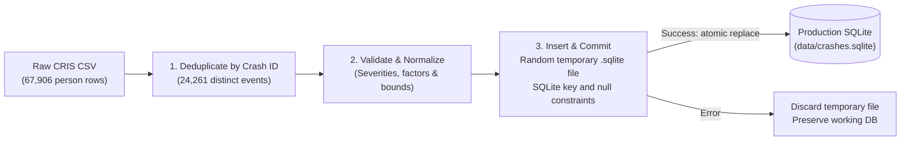

# Exploratory Data Analysis & Data Cleaning Documentation

This document records the exploratory data analysis (EDA), data quality findings, cleaning decisions, and mathematical reference totals for the TxDOT Crash Records Information System (CRIS) export for the **Lubbock TxDOT District (2020–2026)**.

---

## 1. Source and Record Grain

### 1.1 Source Export Overview
The raw dataset (`district_crashes.csv`) is an official CRIS export containing **67,906 rows, 94 columns, and 24,261 distinct Crash IDs**. 
- **Physical Line 12 Header**: Physical lines 1–11 contain export metadata, query definitions, and TxDOT's legal disclaimer. The column header begins on physical line 12. The ingestion pipeline dynamically identifies the header row using `Crash ID` and `Crash Severity`, verifies all required columns, handles an optional UTF-8 byte-order mark (`utf-8-sig`), and includes the preamble in its cleaning report.
- **District Scope**: The dataset covers the **17 counties** comprising the TxDOT Lubbock District: Bailey, Castro, Cochran, Crosby, Dawson, Floyd, Gaines, Garza, Hale, Hockley, Lamb, Lubbock, Lynn, Parmer, Swisher, Terry, and Yoakum.
- **Severity Scope**: The export is filtered to injury crashes: **K** (Fatal), **A** (Suspected Serious Injury), **B** (Suspected Minor Injury), and **C** (Possible Injury). Non-injury (Property Damage Only / O) crashes are not included in this export.

### 1.2 Record Grain vs. Analysis Grain
- **Source Grain**: Person-level rows for people involved in crashes. Crash and vehicle attributes repeat across those rows; the preamble reports 67,906 persons across 48,043 units.
- **Analytical Grain**: One record per **distinct crash event** (`Crash ID`).
- **Counting Discrepancy**: Treating raw CSV rows as crash counts would overstate actual crashes by approximately **180%** (67,906 rows vs. 24,261 unique crashes). All downstream crash metrics use **distinct Crash IDs**.
- **Fatal Crashes vs. Fatalities**: There are **1,607 person rows with `Crash Severity = K`**, representing people involved in fatal crashes. These rows correspond to **624 distinct fatal crashes**. There are **707 fatalities**, independently confirmed by counting `Person Injury Severity = K` and by summing `Crash Death Count` once per Crash ID. A person involved in a fatal crash is not necessarily a fatality. The required severity metric is the **624 crash events**, not the person-row or fatality count.

---

## 2. Selected Fields & Modeling Decisions

Only attributes needed for crash-level analysis are retained in the runtime database. This reduces storage and avoids carrying unused person, vehicle, and address fields into API responses:

| Field Name | Target Column | Type | Rationale & Cleaning Rules |
|---|---|---|---|
| `Crash ID` | `crash_id` | `TEXT (PK)` | Primary entity identifier; deduplicates person-level records into single crash events. |
| `Crash Date` | `crash_date` | `TEXT` | Parsed to ISO 8601 (`YYYY-MM-DD`). Invalid dates are set to `NULL` to preserve crash entity in severity/factor analyses. |
| `Crash Year` | `year` | `INTEGER` | Calendar year for temporal partitioning. Cross-checked with `crash_date`; missing years are populated from valid dates. |
| `County` | `county` | `TEXT` | Uppercase with collapsed whitespace; missing values become `UNKNOWN`. The supplied export contains 17 district counties, but the cleaner does not enforce a county allowlist. The API accepts county filters present in the built snapshot. |
| `Crash Severity` | `severity` | `TEXT` | Extracted code (`K`, `A`, `B`, `C`). Descriptive suffixes (e.g., `'K - FATAL'`) stripped. |
| `Latitude` | `latitude` | `REAL` | Parsed as WGS84 float; validated against Texas bounding coordinates (`25°N – 37°N`); rounded to 6 decimal places (~0.1m precision). |
| `Longitude` | `longitude` | `REAL` | Parsed as WGS84 float; validated against Texas bounding coordinates (`-107°W – -93°W`); rounded to 6 decimal places. |
| Coordinated Flag | `has_coordinates` | `INTEGER` | `1` if coordinates are finite and within bounds, `0` if missing or sentinel (`No Data`, `-1`, `0`). |
| `Contributing Factors` | `factors` (table) | `1:N Table` | Crash-level combined factors split on semicolons (`;`), trimmed, uppercase normalized, and deduplicated per crash. |
| Factor Status | `factor_status` | `TEXT` | Categorized as `'recorded'`, `'none'` (explicit `NONE` recorded), or `'missing'` (sentinel or empty). |

### Excluded Attributes
Unused columns include person age, gender and ethnicity, driver ZIP code, alcohol-related fields, vehicle make/model/year, street names and numbers, and roadway classifications. Names, driver license numbers, VINs, insurance details, and officer narratives are not columns in this export; the cleaner does not perform redaction of those fields. The runtime database is approximately 7.2 MiB compared with the 74 MiB source CSV. The original person-level CSV remains available separately through the documented public download.

---

## 3. Observed Data Quality Findings

| Quality Dimension | Metric / Observation | Pipeline Action & Resolution |
|---|---|---|
| **Attribute Agreement** | 0 conflicting attributes across 24,261 IDs | Validated that repeated person rows for the same `Crash ID` share identical crash-level values. Any conflict halts the build with an explicit error. |
| **Identical Rows** | 295 duplicate full rows | Counted in the cleaning report. Identical exported rows do not establish duplicate crash events; grouping by Crash ID prevents them from inflating crash totals. |
| **Geocoding Completeness** | 23,412 crashes with valid coordinates (96.50%) 849 crashes with `No Data` / unusable sentinels (3.50%) | Both coordinates set to `NULL` with `has_coordinates = 0` for uncoordinated crashes. **Crucial decision:** Uncoordinated crashes remain 100% included in severity, factor, and temporal analyses; the interactive map renders the 23,412 points with an explicit disclosure of the 849 unmapped incidents. |
| **Explicit Factor "NONE"** | 104 crashes with explicit `NONE` | `NONE` is an explicit reporting choice, not a contributing hazard. Excluded from factor rankings; tracked separately in `factor_status = 'none'` and reported in API responses. |
| **Date, Year, County and Factor Completeness** | 0 invalid dates; 0 unresolved missing years; 0 missing counties; 0 missing factors | These are observed counts for this export. The cleaner retains invalid dates as `NULL`, derives missing/invalid years from valid dates where possible, maps missing counties to `UNKNOWN`, and tracks missing factors separately. |
| **Temporal Boundary Incompleteness** | Span: 2020-01-01 to 2026-10-20 Processed by TxDOT: 2026-10-22 | October 2026 and calendar year 2026 are partial periods. Recent crash records are subject to reporting lags. Boundary periods are flagged with `partial_period = true`; no full-year extrapolation is performed. |
| **Missing Sentinels** | Blank values, `No Data`, `N/A`, `NULL`, `UNKNOWN`, `-1` | Rules depend on the field: missing IDs fail validation; dates/years are parsed; missing counties become `UNKNOWN`; factor sentinels are excluded from rankings. Coordinates must be finite and inside a broad Texas rectangle (latitude 25–37, longitude -107 to -93), which also rejects `0` and `-1`. Zero is not a general missing-value token and would be retained if supplied as a factor. These bounds do not validate district membership. |

---

## 4. Ingestion Pipeline & Cleaning Workflow

The cleaning script ([data/clean.py](data/clean.py)) implements an atomic, zero-external-dependency transformation:

### Safety & Resilience Guarantees
1. **Atomic Snapshots**: The processor creates a randomly named temporary `.sqlite` file in the destination directory. SQLite enforces primary-key, foreign-key and required-value constraints while inserting records. After a successful commit, `os.replace` publishes the snapshot atomically. Input-validation, insert or commit failures leave the existing destination untouched. The cleaner does not run a separate `PRAGMA integrity_check`, `foreign_key_check`, or comparison against the preamble's declared totals; a structurally valid but incomplete export therefore needs independent completeness verification.
2. **Strict Invariant Checks**: Missing `Crash ID`, unrecognized severity codes (not K, A, B, or C), date/year mismatches, or conflicting attributes immediately throw `DataQualityError` and terminate execution.

---

## 5. Independent Reference Totals & Benchmark Metrics

The following totals were independently computed directly from the validated crash snapshot:

### 5.1 Crash Severity Breakdown (Total: 24,261)
*Counts represent distinct crash events, not total casualties.*

| Severity Code | Classification | Distinct Crashes | Proportion |
|---|---|---|---|
| **K** | Fatal Crash | **624** | 2.57% |
| **A** | Suspected Serious Injury | **1,546** | 6.37% |
| **B** | Suspected Minor Injury | **7,224** | 29.78% |
| **C** | Possible Injury | **14,867** | 61.28% |
| **Total** | **All Severities** | **24,261** | **100.00%** |

### 5.2 Top 5 Contributing Factors
*Counts reflect the number of distinct crashes where the factor was cited. A single crash may report multiple factors; percentages are calculated relative to total filtered crashes (24,261).*

| Rank | Contributing Factor | Distinct Crashes | % of Total Crashes |
|---|---|---|---|
| 1 | **FAILED TO CONTROL SPEED** | **5,559** | 22.91% |
| 2 | **FAILED TO YIELD RIGHT OF WAY - STOP SIGN** | **2,428** | 10.01% |
| 3 | **FAILED TO YIELD RIGHT OF WAY - TURNING LEFT** | **2,346** | 9.67% |
| 4 | **FAILED TO DRIVE IN SINGLE LANE** | **2,334** | 9.62% |
| 5 | **UNSAFE SPEED** | **2,034** | 8.38% |

*(Note: 104 crashes with explicit `NONE` and 0 missing factors are excluded from factor rankings).*

### 5.3 Annual Temporal Trends
*Dates span 2020-01-01 through 2026-10-20. 2026 is partial.*

| Year | Distinct Crashes | % of Total | Notes |
|---|---|---|---|
| 2020 | **3,351** | 13.81% | Observed calendar-year coverage |
| 2021 | **3,971** | 16.37% | Peak incident year |
| 2022 | **3,716** | 15.32% | Observed calendar-year coverage |
| 2023 | **3,673** | 15.14% | Observed calendar-year coverage |
| 2024 | **3,452** | 14.23% | Observed calendar-year coverage |
| 2025 | **3,444** | 14.20% | Observed calendar-year coverage |
| 2026 | **2,654** | 10.94% | **Partial** (through October 20, 2026) |
| **Total** | **24,261** | **100.00%** | **7 Years** |

### 5.4 Geocoding & Spatial Coverage Summary

| Metric | Count | Proportion | Handling in Downstream Application |
|---|---|---|---|
| **Coordinated Crashes** | **23,412** | 96.50% | Plotted as interactive circle markers on the Leaflet OpenStreetMap dashboard, color-coded by severity (K, A, B, C). |
| **Uncoordinated Crashes** | **849** | 3.50% | Retained in all KPI cards, severity distribution, factor ranking, and timeline charts. Disclosed on the map header badge and information tooltip. |
| **Total Distinct Crashes** | **24,261** | 100.00% | Full dataset population. |

---

## 6. Analytical Limitations

1. **Traffic exposure is not modeled**: Counts alone cannot establish whether one county has higher risk per trip or mile. No analysis of traffic volume or population exposure was performed to explain differences in counts.
2. **2026 is an incomplete year**: Data runs through October 20, 2026. Its total should not be compared directly with a full calendar year as evidence of a safety improvement.
3. **Observed coverage is not reporting completeness**: Calendar-year coverage and zero-filled periods describe the supplied export. They do not prove that every crash was reported or processed. TxDOT's preamble disclaims completeness and timeliness.

