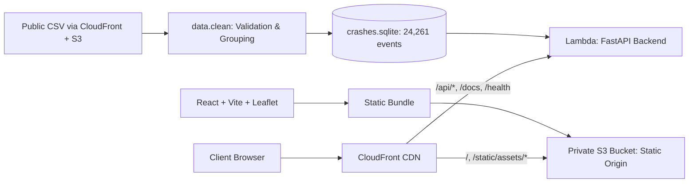

# Crash Analytics

**Crash Analytics** is an end-to-end data pipeline, REST API, and interactive dashboard for exploring **distinct crashes** in the TxDOT Crash Records Information System (CRIS) export for the **Lubbock TxDOT District (2020–2026)**.

The application answers the three core analytical questions:
1. **Crash Severity**: How severe were the crashes (K, A, B, C classifications)?
2. **Contributing Factors**: What driver, roadway, or environmental factors were cited?
3. **Temporal Patterns**: How do crash frequencies vary over years, months, and days of the week?

**Bonus Feature**: Includes an interactive **GIS Crash Map** plotting 23,412 geocoded crash incidents on OpenStreetMap with severity color-coding, county bounds, and coverage disclosures.

- **[Live React Dashboard on CloudFront](https://d9tany0cdnjow.cloudfront.net/)**
- **[Interactive OpenAPI / Swagger Documentation](https://d9tany0cdnjow.cloudfront.net/docs)**

---

## Architecture Overview



---

## 1. Local Development & Quickstart

### Prerequisites & Environment
- **Python Runtime & Virtual Environment**: Python 3.12+ (3.13 tested). A Python virtual environment (`.venv`) is used to isolate dependencies as shown in the quickstart below.
- **Node.js Runtime**: Node.js 24 is recommended and used in CI. Vite and its React plugin support `^20.19.0 || >=22.12.0`; earlier Node 20 releases are unsupported.
- **Environment Variables**: **None required**. You do **not** need a `.env` file, database credentials, or AWS keys to run locally. The application ships with the self-contained, prebuilt `data/crashes.sqlite` database snapshot and works immediately. *(Optional: `CRASH_DB_PATH` may be set if you wish to override the default database path).*

### Setup & Run with One Command

```bash
git clone https://github.com/aakashthapa0/crash-analytics.git crash-analytics
cd crash-analytics
python3 -m venv .venv
source .venv/bin/activate

# Install runtime dependencies (or use requirements-dev.txt to also include pytest):
python -m pip install -r requirements.txt
# (Optional to run test suite: python -m pip install -r requirements-dev.txt)

# Install frontend dependencies from the lockfile in the frontend folder.
npm ci --prefix frontend

# Start both FastAPI (port 8000) and Vite dev server (port 5173) concurrently:
python scripts/dev.py
```

The macOS/Linux launcher starts both servers and stops them with Ctrl+C, or if
either server exits. Ports 8000 and 5173 must be free.

### Local URLs
| Service | URL | Description |
|---|---|---|
| **Frontend Dev Server** | <http://127.0.0.1:5173/> | Vite with Hot Module Replacement (HMR) and API proxying |
| **Backend API Server** | <http://127.0.0.1:8000/> | FastAPI backend (`uvicorn --reload`), serving API routes and documentation only |
| **Interactive Swagger Docs** | <http://127.0.0.1:8000/docs> | Interactive OpenAPI exploration and test client |
| **API Health Check** | <http://127.0.0.1:8000/health> | Service liveness status |

Open the dashboard on port 5173. The backend does not serve frontend files;
requests to its `/` and `/static/*` paths return 404.

To run the backend only:
```bash
python -m uvicorn backend.api:app --reload
```

---

## 2. Data Correctness & Methodology

### 2.1 The Counting Grain
The raw export contains **67,906 rows** across 94 columns. However, these represent **persons involved** (drivers, passengers, pedestrians) rather than distinct crashes. 
- The dataset preamble explicitly reports **24,261 distinct crashes**, 48,043 units, and 67,906 persons.
- Treating raw CSV rows as crash counts would introduce an overcount of **~180%**.
- The cleaning script validates that repeated crash-level attributes agree across all person rows, then stores exactly **one record per distinct `Crash ID`**.

### 2.2 Reference Benchmark Totals

#### Severity Breakdown (Total: 24,261)
*Counts represent distinct crash events, not total individual injuries/fatalities.*
- **K (Fatal Injury)**: **624** (2.57%)
- **A (Suspected Serious Injury)**: **1,546** (6.37%)
- **B (Suspected Minor Injury)**: **7,224** (29.78%)
- **C (Possible Injury)**: **14,867** (61.28%)

#### Top 5 Contributing Factors
*Distinct crashes recording each factor (percentages divide by total 24,261 crashes; crashes can cite multiple factors).*
1. **FAILED TO CONTROL SPEED**: **5,559** (22.91%)
2. **FAILED TO YIELD RIGHT OF WAY - STOP SIGN**: **2,428** (10.01%)
3. **FAILED TO YIELD RIGHT OF WAY - TURNING LEFT**: **2,346** (9.67%)
4. **FAILED TO DRIVE IN SINGLE LANE**: **2,334** (9.62%)
5. **UNSAFE SPEED**: **2,034** (8.38%)

*(104 crashes citing explicit `NONE` are excluded from factor rankings and reported separately).*

#### Temporal Trend (Annual)
*Dates span 2020-01-01 through 2026-10-20. 2026 is partial.*
- **2020**: 3,351
- **2021**: 3,971 (peak incident year)
- **2022**: 3,716
- **2023**: 3,673
- **2024**: 3,452
- **2025**: 3,444
- **2026**: 2,654 (partial through October 20, 2026)
- **Total**: **24,261**

#### Geocoding & Spatial Coverage
- **Coordinated Crashes**: **23,412** (96.50%) have valid, bounded WGS84 coordinates.
- **Uncoordinated Crashes**: **849** (3.50%) have `No Data` or sentinel coordinates. They are retained in all analytical totals and disclosed on the map view.

### 2.3 Rebuilding the SQLite Snapshot

[data/clean.py](data/clean.py) uses the Python standard library to download the
[source CSV](https://d9tany0cdnjow.cloudfront.net/data/district_crashes.csv)
(approximately 74 MiB) and build `data/crashes.sqlite`. No AWS credentials are required.

```bash
# Download, clean, and rebuild the bundled snapshot:
python -m data.clean

# Write to a different destination:
python -m data.clean --output ./crashes.sqlite

# Use a local CSV instead:
python -m data.clean /path/to/district_crashes.csv
```

The existing database is replaced only after input validation and a successful
database commit. The cleaning report records a SHA-256 file fingerprint for
traceability; downloads are not compared against an expected hash.

See [EDA.md](EDA.md) and [data/README.md](data/README.md) for cleaning rules,
quality findings, and validation limits.

---

## 3. REST API Contract

### Endpoints & Parameter Reference

| Endpoint | Method | Accepted Query Parameters | Description |
|---|---|---|---|
| `/api/v1/severity` | `GET` | `county`, `year`, `severity` | Computes crash counts and percentages across all injury severity classifications (`K`, `A`, `B`, `C`). |
| `/api/v1/factors` | `GET` | `county`, `year`, `severity`, `limit` | Ranks contributing factors by distinct crash frequency. Returns counts, percentages, and separate tallies for `NONE`/missing. |
| `/api/v1/trends` | `GET` | `county`, `year`, `severity`, `granularity` | Computes temporal patterns. Supports zero-filled chronological timelines (`month`, `year`) and day-of-week distribution (`day_of_week`). |
| `/api/v1/counties` | `GET` | `county`, `year`, `severity` | Ranks counties by distinct crashes, including crashes without coordinates or valid dates. |
| `/api/v1/points` | `GET` | `county`, `year`, `severity`, `limit` | Returns spatial coordinates (`lat`, `lon`), severity, date, and a representative recorded factor for GIS mapping. |
| `/api/v1/metadata` | `GET` | *None* | Returns dataset provenance, date coverage, quality metrics, and valid filter choices for API clients. |
| `/health` | `GET` | *None* | Returns `{"status":"ok"}` to indicate service liveness. |
| `/docs` | `GET` | *None* | Interactive OpenAPI / Swagger UI documentation and live test client. |

#### Parameter Specifications
- **`county`** *(string, optional)*: Case-insensitive name of any of the 17 Lubbock District counties (e.g., `LUBBOCK`, `HALE`, `LYNN`).
- **`year`** *(integer, optional)*: Calendar year between `2020` and `2026`.
- **`severity`** *(string, repeatable, optional)*: Filter by one or more severity codes: `K` (Fatal), `A` (Suspected Serious), `B` (Suspected Minor), `C` (Possible Injury). Repeat for multi-select (e.g., `?severity=K&severity=A`).
- **`limit`** *(integer, optional)*: Maximum results returned. Allowed range: `1`–`1000` on `/factors`; `1`–`50000` on `/points`.
- **`granularity`** *(string, optional, default: `month`)*: Temporal aggregation for `/trends`. Allowed values: `'month'`, `'year'`, `'day_of_week'`. The former `'week'` alias is rejected with HTTP 422.

The five analysis endpoints enforce strict query validation: unknown parameters or invalid values return **422 Unprocessable Entity**.

### Example Queries

```bash
CRASH_URL='https://d9tany0cdnjow.cloudfront.net'

# 1. Severity counts and percentages (filtered by county & year)
curl "$CRASH_URL/api/v1/severity?county=LUBBOCK&year=2023"

# 2. Top contributing factors (filtered by county, severity; limit 5)
curl "$CRASH_URL/api/v1/factors?county=HALE&severity=K&limit=5"

# 3. Temporal trends (monthly timeline filtered by severity)
curl "$CRASH_URL/api/v1/trends?severity=K&granularity=month"

# 4. Day-of-week crash distribution
curl "$CRASH_URL/api/v1/trends?county=LUBBOCK&granularity=day_of_week"

# 5. Spatial points for mapping (filtered by county, year; limit 1000)
curl "$CRASH_URL/api/v1/points?county=LUBBOCK&year=2024&limit=1000"

# 6. Metadata and filter choices
curl "$CRASH_URL/api/v1/metadata"

# 7. Service liveness
curl "$CRASH_URL/health"
```

### Response Examples

These are complete responses from the current API and packaged dataset. Expand an endpoint to inspect its JSON. The backend changes were deployed on October 27, 2026.

The five analysis endpoints share `filters`, `total_crashes`, and `results`. Filters are normalized by the API; `total_crashes` counts distinct Crash IDs before any result limit or coordinate/date exclusion.

<details>
<summary>Severity: <code>GET /api/v1/severity</code></summary>

All four severity buckets are returned, including zero counts. Percentages use the full filtered crash total.

HTTP 200:

```json
{
  "filters": {
    "county": null,
    "year": null,
    "severity": []
  },
  "total_crashes": 24261,
  "results": [
    {
      "severity": "K",
      "label": "Fatal injury",
      "crashes": 624,
      "percentage": 2.572
    },
    {
      "severity": "A",
      "label": "Suspected serious injury",
      "crashes": 1546,
      "percentage": 6.3724
    },
    {
      "severity": "B",
      "label": "Suspected minor injury",
      "crashes": 7224,
      "percentage": 29.7762
    },
    {
      "severity": "C",
      "label": "Possible injury",
      "crashes": 14867,
      "percentage": 61.2794
    }
  ]
}
```

</details>

<details>
<summary>Contributing factors: <code>GET /api/v1/factors?limit=1</code></summary>

The ranking limit does not change the total or percentage denominator. NONE and missing factors are counted separately; a crash may have multiple factors, so summed percentages can exceed 100%.

HTTP 200:

```json
{
  "filters": {
    "county": null,
    "year": null,
    "severity": []
  },
  "total_crashes": 24261,
  "results": [
    {
      "factor": "FAILED TO CONTROL SPEED",
      "crashes": 5559,
      "percentage": 22.9133
    }
  ],
  "no_recorded_factor": 104,
  "missing_factor": 0
}
```

</details>

<details>
<summary>Monthly trends: <code>GET /api/v1/trends?year=2026</code></summary>

Month is the default grouping. Timeline gaps are zero-filled and incomplete boundary periods are marked with partial_period.

HTTP 200:

```json
{
  "filters": {
    "county": null,
    "year": 2026,
    "severity": []
  },
  "total_crashes": 2654,
  "granularity": "month",
  "excluded_invalid_dates": 0,
  "results": [
    {
      "period": "2026-01",
      "crashes": 255,
      "partial_period": false
    },
    {
      "period": "2026-02",
      "crashes": 229,
      "partial_period": false
    },
    {
      "period": "2026-03",
      "crashes": 280,
      "partial_period": false
    },
    {
      "period": "2026-04",
      "crashes": 265,
      "partial_period": false
    },
    {
      "period": "2026-05",
      "crashes": 278,
      "partial_period": false
    },
    {
      "period": "2026-06",
      "crashes": 270,
      "partial_period": false
    },
    {
      "period": "2026-07",
      "crashes": 260,
      "partial_period": false
    },
    {
      "period": "2026-08",
      "crashes": 331,
      "partial_period": false
    },
    {
      "period": "2026-09",
      "crashes": 322,
      "partial_period": false
    },
    {
      "period": "2026-10",
      "crashes": 164,
      "partial_period": true
    }
  ]
}
```

</details>

<details>
<summary>Yearly trends: <code>GET /api/v1/trends?year=2026&amp;granularity=year</code></summary>

The same trend fields are returned for yearly grouping. total_crashes includes undated crashes; excluded_invalid_dates explains why charted counts may be smaller.

HTTP 200:

```json
{
  "filters": {
    "county": null,
    "year": 2026,
    "severity": []
  },
  "total_crashes": 2654,
  "granularity": "year",
  "excluded_invalid_dates": 0,
  "results": [
    {
      "period": "2026",
      "crashes": 2654,
      "partial_period": true
    }
  ]
}
```

</details>

<details>
<summary>Day-of-week trends: <code>GET /api/v1/trends?granularity=day_of_week</code></summary>

Returns Monday–Sunday buckets. Percentages use crashes with valid dates as the denominator. The former week alias is rejected with HTTP 422.

HTTP 200:

```json
{
  "filters": {
    "county": null,
    "year": null,
    "severity": []
  },
  "total_crashes": 24261,
  "granularity": "day_of_week",
  "excluded_invalid_dates": 0,
  "results": [
    {
      "period": "Monday",
      "crashes": 3396,
      "percentage": 13.9978,
      "partial_period": false
    },
    {
      "period": "Tuesday",
      "crashes": 3452,
      "percentage": 14.2286,
      "partial_period": false
    },
    {
      "period": "Wednesday",
      "crashes": 3532,
      "percentage": 14.5583,
      "partial_period": false
    },
    {
      "period": "Thursday",
      "crashes": 3614,
      "percentage": 14.8963,
      "partial_period": false
    },
    {
      "period": "Friday",
      "crashes": 3903,
      "percentage": 16.0875,
      "partial_period": false
    },
    {
      "period": "Saturday",
      "crashes": 3510,
      "percentage": 14.4677,
      "partial_period": false
    },
    {
      "period": "Sunday",
      "crashes": 2854,
      "percentage": 11.7637,
      "partial_period": false
    }
  ]
}
```

</details>

<details>
<summary>Counties: <code>GET /api/v1/counties</code></summary>

All counties are ranked by crash count, with alphabetical ties. The pie chart displays the top five and combines the remaining counties as “Other counties”; percentages use all filtered crashes.

```json
{
  "filters": {
    "county": null,
    "year": null,
    "severity": []
  },
  "total_crashes": 24261,
  "results": [
    {
      "county": "LUBBOCK",
      "crashes": 19100
    },
    {
      "county": "HALE",
      "crashes": 830
    },
    {
      "county": "GAINES",
      "crashes": 739
    },
    {
      "county": "HOCKLEY",
      "crashes": 638
    },
    {
      "county": "DAWSON",
      "crashes": 443
    },
    {
      "county": "LAMB",
      "crashes": 339
    },
    {
      "county": "TERRY",
      "crashes": 320
    },
    {
      "county": "PARMER",
      "crashes": 307
    },
    {
      "county": "GARZA",
      "crashes": 229
    },
    {
      "county": "SWISHER",
      "crashes": 224
    },
    {
      "county": "LYNN",
      "crashes": 209
    },
    {
      "county": "BAILEY",
      "crashes": 199
    },
    {
      "county": "CASTRO",
      "crashes": 197
    },
    {
      "county": "YOAKUM",
      "crashes": 191
    },
    {
      "county": "CROSBY",
      "crashes": 141
    },
    {
      "county": "FLOYD",
      "crashes": 101
    },
    {
      "county": "COCHRAN",
      "crashes": 54
    }
  ]
}
```

</details>

<details>
<summary>Map points: <code>GET /api/v1/points?limit=1</code></summary>

total_crashes includes every matching crash; total_points counts the returned rows after coordinate exclusions and the result limit. Each point retains the fields used by map markers and popups. factor is the alphabetically first recorded factor, with No factor recorded as the fallback.

HTTP 200:

```json
{
  "filters": {
    "county": null,
    "year": null,
    "severity": []
  },
  "total_crashes": 24261,
  "results": [
    {
      "lat": 33.596085,
      "lon": -101.923698,
      "severity": "C",
      "id": "21698846",
      "date": "2026-10-20",
      "county": "LUBBOCK",
      "factor": "FAILED TO CONTROL SPEED"
    }
  ],
  "total_points": 1
}
```

</details>

<details>
<summary>Dataset metadata: <code>GET /api/v1/metadata</code></summary>

Dataset coverage, definitions, coordinate quality, and valid query choices are centralized here. Coverage describes the full dataset, not a filtered selection.

HTTP 200:

```json
{
  "scope": "Supplied Lubbock TxDOT district K/A/B/C injury-crash export",
  "crashes": 24261,
  "coverage": {
    "first_date": "2020-01-01",
    "last_date": "2026-10-20"
  },
  "quality": {
    "unusable_coordinates": 849
  },
  "definitions": {
    "counting_unit": "One distinct Crash ID, not persons or vehicles",
    "factors": "Distinct crashes recording each normalized contributing factor; NONE excluded",
    "factor_percentage": "Factor crash count / all filtered crashes, including NONE and missing; percentages may exceed 100% in total",
    "coverage": "Observed dates, not proof of complete reporting. Boundary periods may be partial"
  },
  "available_filters": {
    "counties": [
      "BAILEY",
      "CASTRO",
      "COCHRAN",
      "CROSBY",
      "DAWSON",
      "FLOYD",
      "GAINES",
      "GARZA",
      "HALE",
      "HOCKLEY",
      "LAMB",
      "LUBBOCK",
      "LYNN",
      "PARMER",
      "SWISHER",
      "TERRY",
      "YOAKUM"
    ],
    "years": [
      2020,
      2021,
      2022,
      2023,
      2024,
      2025,
      2026
    ],
    "severities": {
      "K": "Fatal injury",
      "A": "Suspected serious injury",
      "B": "Suspected minor injury",
      "C": "Possible injury"
    }
  }
}
```

</details>

<details>
<summary>Health: <code>GET /health</code></summary>

Reports service liveness only; it does not query the database.

HTTP 200:

```json
{
  "status": "ok"
}
```

</details>

### Error Responses

The five analysis endpoints reject unknown parameters, repeated scalar parameters, invalid values, and out-of-range limits with HTTP 422. Metadata and health do not use the shared filter validator. Missing routes return HTTP 404.

Errors use an `error` object with `code` and `message`; parameter parsing errors also include a `details` array.

<details>
<summary>Invalid query value: <code>GET /api/v1/trends?granularity=week</code> — HTTP 422</summary>

```json
{
  "error": {
    "code": "invalid_parameter",
    "message": "Check query parameters",
    "details": [
      {
        "parameter": "query.granularity",
        "message": "Input should be 'month', 'year' or 'day_of_week'"
      }
    ]
  }
}
```

</details>

<details>
<summary>Unknown API route: <code>GET /api/v1/missing</code> — HTTP 404</summary>

```json
{
  "error": {
    "code": "not_found",
    "message": "Not Found"
  }
}
```

</details>

---

## 4. Frontend Dashboard (Bonus Feature)

Built with React 19, Vite, and vanilla CSS. One `/api/v1/metadata` request supplies
county/year/severity choices, labels, coverage dates, counting units, map quality,
and CSV export details; filter changes reuse it. Metadata loading or errors disable
dependent controls and exports, with retry support. Colors and map centroids are configured separately.

Source layout in `frontend/src/`:

```text
main.jsx       React entry point
App.jsx        App root
pages/         Dashboard composition and shared filter state
components/    Sidebar, filters, summary cards, charts, and map
api/           API URLs and filtered endpoint builder
hooks/         JSON requests, dashboard data, URL filters, navigation, reveal
constants/     Dashboard colors and map geography/colors
utils/         Formatting, filter queries, chart calculations, CSV export
styles.css     Dashboard styles
```

### Crash Analytics Overview
- **Metric Cards**: Four [animated totals](frontend/src/components/AnimatedNumber.jsx) count distinct injury crashes, fatal + serious crashes (K + A), fatal crashes (K), and crashes with NONE/missing factors. All values count crash events, including the fatal-crash total.
- **Time Charts**: Filtered bars show yearly, January–December, and weekday counts using API periods and partial flags. Monthly year cards show counts and each month's share of that year's dated crashes. County/year/severity filters apply; dashed outlines mark incomplete reporting.
- **Chart Layout**: Equal-height desktop panels split 70/30 and stack on compact screens. The timeline sets the height; the pie fits above its wrapping legend and grows with monthly details. Hover, focus, or select a slice/legend for county, count, and percentage. The map sits below.
- **Contributing Factors Explorer**: Ranks distinct crash counts and percentages, initially showing five factors with **See more / See less**. NONE/missing factors are excluded from rankings, combined in the summary card, and reported separately by the API.
- **Deep-linking & Shareable URLs**: County/year/severity filters sync to the URL; chart view sets trend granularity. Loading/errors hide statistics and disable exports, with retry support. The map fetches independently and uses its own coverage response, staying hidden until statistics load. Sections reveal in page order; reduced motion shows them immediately.

### Crash Map (GIS Explorer)
- **High-Performance Canvas Rendering**: [Leaflet and OpenStreetMap](frontend/src/components/CountyMap.jsx) display 23,412 crash coordinates as lightweight canvas circle markers.
- **Severity Color-Coding**: The [map palette](frontend/src/constants/map.js) uses red for fatal (K), orange for serious (A), gold for minor (B), and sage for possible injury (C).
- **Interactive Inspection**: Marker popups show Crash ID, date, county, severity, and the alphabetically first normalized factor as a representative record, without ranking causes.
- **Spatial Coverage Disclosure**: The badge shows mapped count and percentage for the selection; its tooltip gives dataset-wide unusable-coordinate counts from metadata.
- **County Zoom**: County selection zooms to its configured centroid; Home restores the district.

---

## 5. AWS Production Deployment

In `us-east-1`, private S3 buckets hold the static frontend and source CSV; Lambda packages
FastAPI with the read-only SQLite snapshot, avoiding a separate database server.
CloudFront provides HTTPS and one browser origin for assets, data, and API requests.

### CloudFront & Multi-Origin Routing

Distribution `E1JSKILKOTG8BZ` serves [the public dashboard](https://d9tany0cdnjow.cloudfront.net/):

| Path Pattern | Origin | Cache Policy | Details |
|---|---|---|---|
| `/static/assets/*` | Private frontend S3 | `CachingOptimized` | Compressed, content-hashed assets; one-year immutable caching. |
| `/data/district_crashes.csv` | Private data S3 | `CachingOptimized` | Public download of this file only; no AWS credentials needed. |
| `/api/*`, `/docs*`, `/openapi.json`, `/health` | API Lambda | `CachingDisabled` | `AllViewerExceptHostHeader` forwards query parameters. |
| Default (`/`) | Private frontend S3 | `CachingDisabled` | Root `index.html` uses `no-store`; CloudFront adds CSP, HSTS, and frame protection. |

### Origin Security & Isolation

- **Frontend Origin**: `lubbock-crash-frontend-626619999361-us-east-1` uses Block Public Access, disabled ACLs, AES256 encryption, and CloudFront OAC. Its policy permits this distribution's reads and denies insecure transport; unauthenticated direct access returns 403.
- **Source Data**: `lubbock-crash-data-626619999361-us-east-1` uses the same protections. CloudFront exposes only `data/district_crashes.csv`, without bucket listing.
- **API Origin**: The Lambda Function URL uses `AuthType=NONE` for public API access.
- **Minimal Permissions**: The API execution role needs no S3 access; bucket permissions are scoped to CloudFront and the intended objects.
- **Zero Server Overhead**: On-demand Lambda runs Python 3.13 on x86_64 and scales to zero when idle; no EC2, RDS, or NAT gateway is used.

### GitHub Actions

[The workflow](.github/workflows/deploy.yml) tests and builds both applications,
packaging the API with the checked-in SQLite snapshot. Pushes to `main` deploy after checks pass;
pull requests and forks run checks without deployment credentials. Manual releases
use **Actions → Test and deploy → Run workflow → main**.

Each release:

1. Downloads the exact tested build artifacts.
2. Updates the API Lambda and checks its public endpoint.
3. Uploads hashed frontend assets, then `index.html`.
4. Runs production smoke checks through CloudFront.

Releases run one at a time. Old assets remain available to open tabs; uncached
HTML avoids CloudFront invalidations. Failed checks prevent deployment; a failed
release stops without automatically rolling back earlier steps.

[OIDC](https://docs.github.com/en/actions/how-tos/secure-your-work/security-harden-deployments/oidc-in-aws)
provides temporary credentials, with no stored AWS keys. The deployment role trusts
only this repository's `main` branch and can update API code and upload frontend
objects; it cannot delete files, change infrastructure, or modify source data.
Its ARN is stored in the repository variable `AWS_DEPLOY_ROLE_ARN`.

[infra/github-actions.yaml](infra/github-actions.yaml) defines the OIDC provider
and deployment role only. Hosting resources remain managed in AWS. Account migrations require updating
the workflow's resource names, URLs, role variable, and template parameters.

### Builds

Local builds from the repository root:

```bash
npm run build --prefix frontend
python scripts/package_lambda.py
```

The frontend build produces the gitignored `frontend/public/` directory, which CI
builds afresh and uploads to S3; generated bundles are not stored in the repository.
The API ZIP contains Python dependencies, backend code as `crash_app/`, and SQLite,
preserving `crash_app.api.handler`. Releases leave the handler, runtime, and routing
unchanged.

### Usage Costs & Security Constraints

- **Assessment cost condition — migration pending**: As of October 27, 2026, the current account's introductory S3 allowance has expired and AWS reports no current-month credits. Lambda, CloudFront, and CloudWatch usage is within reported Free Tier allowances. S3 migration to an eligible account awaits access; current hosting is not verified zero-cost.
- **Rechecking eligibility**: Check account age, offers, credits, and billing before deployment; low usage alone does not establish free hosting. See [AWS Free Tier](https://aws.amazon.com/free/), [S3](https://aws.amazon.com/s3/pricing/), [CloudFront](https://aws.amazon.com/cloudfront/pricing/), and [Lambda pricing](https://aws.amazon.com/lambda/pricing/).
- **Temporary Credentials**: GitHub uses OIDC, Lambda uses its execution role, and CloudFront uses OAC for private S3 access.
- **Public URL**: [The dashboard](https://d9tany0cdnjow.cloudfront.net/) and public API require no authentication or AWS credentials.

---

## 6. Automated Tests & Verification

Python tests live in `tests/`; frontend tests live in `frontend/tests/`, separate
from application code in `frontend/src/`. Both suites run locally and in GitHub
Actions, covering data validation, APIs, security headers, and frontend behavior.

### Running Python Tests (39 Passed)
```bash
python -m pip install -r requirements-dev.txt
python -m pytest
```
Covers:
- Deduplication of person rows to distinct crash events.
- Strict factor splitting, normalization, and exclusion of `NONE`.
- Handling of missing dates, invalid coordinates, and malformed CSV rows.
- Atomic database build safety, rollback on failure, and the two-table schema.
- Parameter validation, allowlists, and repeated query parameters.
- FastAPI endpoints (`/severity`, `/factors`, `/trends`, `/points`, `/metadata`, `/health`).
- Function URL invocation via Mangum adapter.
- The API ZIP excludes frontend assets and starts without a frontend build.
- Public-source download, incomplete-download protection, and credential-free cleaning.
- Local launcher cleanup when a server exits or fails to start.

### Running Frontend Tests (18 Passed)
```bash
npm test --prefix frontend
```
Covers:
- URL query state serialization and multi-severity parsing.
- Analytical endpoint URL consistency.
- Reset behavior and default state.
- Parameter validation pass-through to API.
- Year, month, and day-of-week API counts, adaptive chart scales, and consistent filters without an extra unfiltered-year request.
- January–December totals across selected years, monthly counts by year, and reporting coverage.
- Monthly breakdown by actual API periods, including per-year percentages, partial periods, missing months, and zero totals.
- Top-five county ranking, other-county shares, and empty or single-county pie charts.
- Pie and legend tooltips via mouse, keyboard, or selection; navigation for adjacent or stacked chart panels.
- Loading, failures, retries, and late responses without stale data.
- Ordered section reveals, observer cleanup, and reduced-motion or missing-observer fallbacks.
- Filtered NONE/missing counts, map coverage, and popup text safety.
- Dynamic filter-aware CSV export generation and filename convention.
- Metadata-driven filter options, labels, coverage, exports, and loading/error states, tested against alternate dataset years and counties.

### Verifying Frontend Production Build
```bash
npm run build --prefix frontend
```
Emits the production bundle to `frontend/public/`.

### Remote Smoke Checks
```bash
# Verify live CloudFront deployment:
python scripts/smoke.py https://d9tany0cdnjow.cloudfront.net/

# Verify direct API origin:
python scripts/smoke.py https://ah2gf3hitgykmkk5rttpmxf3f40syqig.lambda-url.us-east-1.on.aws/ --api-only
```

---

## 7. Limitations & Production Considerations

1. **Static Snapshot vs. Streaming Ingestion**: The dataset is a point-in-time export. In a real-time production system, new crash reports would stream through an Amazon Kinesis or SQS pipeline into Amazon S3/Glue, triggering an automated cleaning Lambda.
2. **Database Scale**: SQLite is ideal for read-only analytical workloads up to hundreds of thousands of rows. For statewide crash data (> 10 million rows), Amazon Aurora PostgreSQL with PostGIS extension would provide spatial indexing (R-Tree / GiST) and complex polygon intersection queries.
3. **Descriptive, Not Causal**: Contributing factors reflect the investigating officer's judgment at the scene and do not represent formal engineering determinations of crash causality.
4. **Traffic Exposure**: Crash counts are unadjusted for Vehicle Miles Traveled (VMT), traffic volume or population exposure. Counts alone cannot establish per-mile risk or explain differences between counties; no exposure analysis was performed.
5. **Rate Limiting**: The public assessment Function URL is unthrottled with regional concurrency limits. A commercial deployment should place AWS WAF or Amazon API Gateway in front of the API with rate limiting and API key management.

